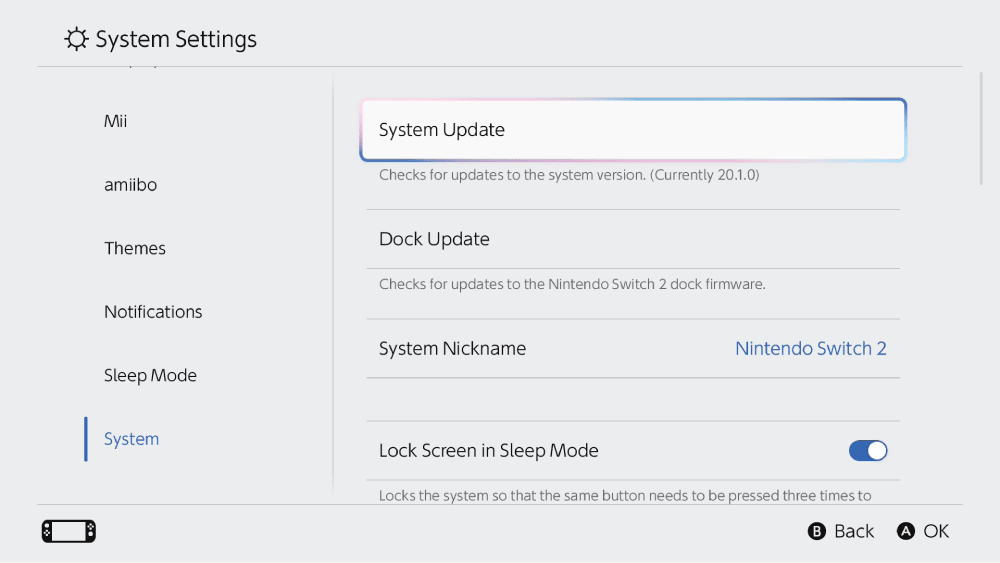

# Checking Firmware Version

### Required Reading

Currently, the only version compatible with homebrew on the Nintendo Switch 2 is **23.0.1**. If you are running a firmware version greater than this, you cannot downgrade your firmware or use homebrew.

While the bug that allows the exploit to work does exist on older versions, the exploit itself has not been ported to those versions. It's also possible that lower firmware versions may have more powerful vulnerabilities that could be exploited in the future.

That being said, if you would rather not wait and want to use homebrew now, it is possible to update to 23.0.1 by locally updating your console with another console running the target firmware version.

If you're on 23.0.1, or okay with missing out on any potential future exploits, we can begin.

::: tip

Always keep your console disconnected from Nintendo's servers to avoid being blacklisted and losing the ability to use homebrew.

:::

### Finding your firmware version

1. Power on your Nintendo Switch 2 console.
2. Navigate to the **System Settings** from the home menu.
3. Scroll down and select **System**.
4. Your firmware version will be displayed under **System Update**.

### Version Table
| From | To | |
|------|----|-|
| 19.0.0 | 23.0.0 | [Updating to 23.0.1](/guide/updating-to-23.0.1/) |
| 23.0.1 | 23.0.1 | [Choosing Your Entrypoint](/guide/choosing-your-entrypoint/) |
| 23.5.0 | 23.5.0 | Not compatible |